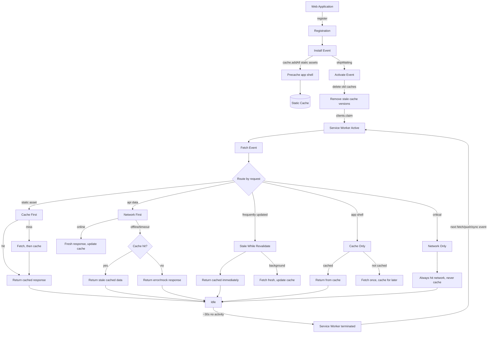

[The previous page](./service-worker-lifecycle.md) covered what a service worker is and how its lifecycle works. This page goes deeper into the part that actually makes an app feel fast and work offline: **how you decide, for every single network request, whether to serve it from cache, fetch it fresh, or do both.** It also walks through background sync, push notifications, and talking to a service worker from the page — all built around one real `sw.js` with five distinct strategies routed by request type.

## Versioned caches and limits

Every cache this service worker creates is named with a version suffix, so shipping a new version never silently reuses (and corrupts) an old cache:

```js
const CACHE_VERSION = "v1";
const STATIC_CACHE = `static-${CACHE_VERSION}`;
const DYNAMIC_CACHE = `dynamic-${CACHE_VERSION}`;
const IMAGE_CACHE = `images-${CACHE_VERSION}`;
const API_CACHE = `api-${CACHE_VERSION}`;
```

Bumping `CACHE_VERSION` on release gives you four brand-new, empty caches, while `activate` (shown on the previous page) deletes any cache name that doesn't match the current version — that's the cleanup mechanism that keeps old data from accumulating forever.

Two more constants cap how much each cache is allowed to hold, and for how long:

```js
// Maximum number of entries per cache (an item count, not a byte size)
const MAX_CACHE_SIZE = {
  images: 50,
  api: 30,
  dynamic: 100,
};

// How long an entry is considered fresh, in milliseconds
const CACHE_DURATION = {
  images: 7 * 24 * 60 * 60 * 1000, // 7 days
  api: 5 * 60 * 1000,              // 5 minutes
  dynamic: 24 * 60 * 60 * 1000,    // 1 day
};
```

:::note Naming
`MAX_CACHE_SIZE` is a count of cached *entries*, not a byte size — a 50-entry image cache could be a few kilobytes or hundreds of megabytes depending on image size. If you need an actual byte budget, you'd need to sum `Response` body sizes yourself; the Cache API doesn't track that for you.
:::

## Routing requests to a strategy

The `fetch` handler is a routing table: it looks at the request's origin and path and picks a strategy function per request type — a pattern worth copying even if your actual strategies differ:

```js
self.addEventListener("fetch", (event) => {
  const { request } = event;
  const url = new URL(request.url);

  // Only handle same-origin requests, plus one named third-party API
  if (url.origin !== location.origin && !url.origin.includes("freeapi.app")) {
    return; // let the browser handle it normally
  }

  if (url.href.includes("freeapi.app")) {
    if (url.href.includes("/dogs/dog/random")) {
      event.respondWith(cacheFirstStrategy(request, IMAGE_CACHE));
    } else if (url.href.includes("/randomproducts")) {
      event.respondWith(networkFirstStrategy(request));
    } else if (url.href.includes("/quotes/quote/random")) {
      event.respondWith(staleWhileRevalidateStrategy(request));
    } else if (url.href.includes("/meals/meal/random")) {
      event.respondWith(cacheOnlyStrategy(request));
    } else if (url.href.includes("/randomjokes")) {
      event.respondWith(networkOnlyStrategy(request));
    } else {
      event.respondWith(networkFirstStrategy(request));
    }
  } else if (request.destination === "image") {
    event.respondWith(cacheFirstStrategy(request, IMAGE_CACHE));
  } else if (url.pathname.startsWith("/api/")) {
    event.respondWith(networkFirstStrategy(request));
  } else {
    event.respondWith(cacheFirstStrategy(request)); // default: static assets
  }
});
```

Returning from the handler without calling `event.respondWith()` (the very first `if`) is deliberate — it tells the browser "I'm not handling this one, do your normal network request," which matters for requests to origins you never intend to intercept.

## Strategy 1: Cache First

**Best for:** static assets — CSS, JS, fonts, images that rarely change.

```js
async function cacheFirstStrategy(request, cacheName = DYNAMIC_CACHE) {
  try {
    const cachedResponse = await caches.match(request);

    if (cachedResponse) {
      updateCacheInBackground(request, cacheName); // refresh for next time, don't block this response
      return cachedResponse;
    }

    const networkResponse = await fetch(request);

    if (networkResponse.ok) {
      const cache = await caches.open(cacheName);
      cache.put(request, networkResponse.clone());
      trimCache(cacheName, MAX_CACHE_SIZE.dynamic);
    }

    return networkResponse;
  } catch (error) {
    const cachedResponse = await caches.match(request);
    if (cachedResponse) return cachedResponse;

    return createMockResponse({
      source: "cache-first-fallback",
      message: "Offline - no cached version available",
    });
  }
}
```

Flow: cache hit → return it instantly (and kick off a background refresh that the *next* request benefits from) → cache miss → fetch, cache the result, return it → total failure with nothing cached → a fallback response.

## Strategy 2: Network First

**Best for:** API data and user content that should be as fresh as possible, but still usable offline.

```js
async function networkFirstStrategy(request, timeout = 5000) {
  try {
    const networkResponse = await fetchWithTimeout(request, timeout);

    if (networkResponse.ok) {
      const cache = await caches.open(API_CACHE);
      cache.put(request, networkResponse.clone());
      trimCache(API_CACHE, MAX_CACHE_SIZE.api);
      return networkResponse;
    }

    throw new Error("Network response not OK");
  } catch (error) {
    const cachedResponse = await caches.match(request);
    if (cachedResponse) return cachedResponse; // stale, but something

    return createMockResponse({
      source: "network-first-fallback",
      message: "Network unavailable and no cached data",
      offline: true,
    });
  }
}

function fetchWithTimeout(request, timeout) {
  return Promise.race([
    fetch(request),
    new Promise((_, reject) =>
      setTimeout(() => reject(new Error("Request timeout")), timeout)
    ),
  ]);
}
```

`fetchWithTimeout` is a classic `Promise.race`: whichever promise settles first wins. If the real `fetch` hasn't resolved within `timeout` milliseconds, the rejection from the timer wins the race, and the `catch` block falls back to cache — without that timeout, a hung connection could leave the user waiting indefinitely instead of getting a (possibly stale) cached answer quickly.

## Strategy 3: Stale While Revalidate

**Best for:** content that updates often but where instant response matters more than absolute freshness — quote-of-the-day, a news feed, a social timeline.

```js
async function staleWhileRevalidateStrategy(request) {
  const cache = await caches.open(DYNAMIC_CACHE);
  const cachedResponse = await cache.match(request);

  const fetchPromise = fetch(request)
    .then((networkResponse) => {
      if (networkResponse.ok) cache.put(request, networkResponse.clone());
      return networkResponse;
    })
    .catch(() => null); // swallow network errors; we may still have a cached copy

  if (cachedResponse) {
    return cachedResponse; // respond instantly, update already in flight
  }

  const freshResponse = await fetchPromise;
  return (
    freshResponse ||
    createMockResponse({
      source: "stale-while-revalidate",
      message: "First load - fetching fresh data",
    })
  );
}
```

:::danger Bug: a Promise is always truthy
The original version of this function ended with:

```js
return fetchPromise || createMockResponse({ ... });
```

`fetchPromise` is a `Promise` **object** — and an object is always truthy, whether the promise it wraps goes on to resolve, reject, or resolve to `undefined`. `fetchPromise || createMockResponse(...)` therefore always evaluates to `fetchPromise`, no matter what happens to the underlying fetch; the mock-response fallback is dead code that can never run. Worse, since nothing `await`s it here, the function can return an *unresolved* `Promise<Response>` directly to `respondWith()` — which happens to still work because `respondWith()` accepts a promise, but it means the "no cache, waiting for network" fallback was never reachable.

The fix above actually `await`s `fetchPromise` and checks its **resolved value**, so a failed fetch (which resolves to `null` after `.catch()`) correctly falls through to the mock response.
:::

## Strategy 4: Cache Only

**Best for:** app shell assets and anything meant to work fully offline by design — if it isn't cached, there's no good fallback anyway.

```js
async function cacheOnlyStrategy(request) {
  const cache = await caches.open(DYNAMIC_CACHE);
  const cachedResponse = await cache.match(request);

  if (cachedResponse) return cachedResponse;

  // Not cached yet: fetch once so future (offline) requests succeed
  try {
    const networkResponse = await fetch(request);
    if (networkResponse.ok) {
      cache.put(request, networkResponse.clone());
      return networkResponse;
    }
  } catch {
    // fall through to the error response below
  }

  return new Response(
    JSON.stringify({
      error: "Cache not available",
      message: "This content is not cached yet. Try loading it once while online.",
    }),
    { status: 503, headers: { "Content-Type": "application/json" } }
  );
}
```

Despite the name, this implementation does make one network request — the very first time a given URL is requested — purely to *populate* the cache so that every subsequent request (including offline ones) can be served from it with zero network dependency.

## Strategy 5: Network Only

**Best for:** anything where a stale answer is actively dangerous — payments, authentication, anything that must reflect the current server state or fail loudly.

```js
async function networkOnlyStrategy(request) {
  try {
    const networkResponse = await fetch(request);
    if (networkResponse.ok) return networkResponse;
    throw new Error("Network response not OK");
  } catch (error) {
    return createMockResponse(
      { source: "network-only-error", message: "Payment failed - network required" },
      503
    );
  }
}
```

No cache is read or written at all — by design. If the network is unavailable, this strategy is supposed to fail; serving a cached payment confirmation, for instance, would be actively wrong.

## Comparing the five strategies

| Strategy | Reads cache first? | Hits network? | Offline behavior | Good for |
| --- | --- | --- | --- | --- |
| **Cache First** | Yes | Only on cache miss (+ background refresh) | Works, may be stale | Static assets |
| **Network First** | Only as fallback | Always tries first (with timeout) | Falls back to stale cache | API data, user content |
| **Stale While Revalidate** | Yes, returned immediately | Always, in the background | Shows stale data | Feeds, frequently-updated content |
| **Cache Only** | Yes, exclusively | Only once, to seed the cache | Works perfectly (if seeded) | App shell, offline-first UI |
| **Network Only** | Never | Always | Fails outright | Payments, auth, anything security-critical |

## Background sync

Background sync lets a page register an intent to do something ("sync these messages") that the browser will retry automatically once connectivity is back — even if the user has since closed the tab.

```js
// main.js — queue an action for later
const registration = await navigator.serviceWorker.ready;
await registration.sync.register("sync-messages");
```

```js
// sw.js — react when the browser decides it's time to sync
self.addEventListener("sync", (event) => {
  if (event.tag === "sync-messages") {
    event.waitUntil(syncMessages());
  }
});

async function syncMessages() {
  const clients = await self.clients.matchAll();
  for (const client of clients) {
    client.postMessage({ type: "sync-complete", timestamp: Date.now() });
  }
}
```

:::warning `localStorage` is invisible to a service worker
It's tempting to stash the pending data in `localStorage` from the page (`localStorage.setItem("pending-sync-...", ...)`) and expect the service worker's `sync` handler to pick it up later. It can't — **`localStorage` is synchronous and scoped to a window; service workers have no access to it at all.** `syncMessages()` above doesn't actually read back whatever was queued — it only announces that a sync happened, which is a sign the queuing half of this feature isn't actually wired up. The correct place to store data that a service worker needs to read is **IndexedDB** (asynchronous, and accessible from both the page and the worker), not `localStorage`.
:::

## Push notifications

```js
self.addEventListener("push", (event) => {
  const data = event.data ? event.data.json() : {};

  event.waitUntil(
    self.registration.showNotification(data.title || "New Notification", {
      body: data.body || "You have a new notification",
      icon: data.icon || "/icon.png",
      data,
    })
  );
});

self.addEventListener("notificationclick", (event) => {
  event.notification.close();
  event.waitUntil(clients.openWindow(event.notification.data.url || "/"));
});
```

A push message wakes the service worker (even if no page is open), and `showNotification` is how it surfaces a system notification. `notificationclick` runs when the user taps it — typically used to open or focus the relevant page.

## Talking to the service worker: `MessageChannel`

A page and "its" service worker don't share a direct reference the way a dedicated worker and its owning page do — the page talks to `navigator.serviceWorker.controller`, and a request/response round trip is built with a `MessageChannel`:

```js
// main.js
function sendMessageToSW(message) {
  return new Promise((resolve, reject) => {
    const channel = new MessageChannel();
    channel.port1.onmessage = (event) =>
      event.data.error ? reject(event.data.error) : resolve(event.data);

    navigator.serviceWorker.controller.postMessage(message, [channel.port2]);
  });
}

await sendMessageToSW({ type: "SKIP_WAITING" });
await sendMessageToSW({ type: "CLEAR_CACHE" });
```

```js
// sw.js
self.addEventListener("message", (event) => {
  if (event.data.type === "SKIP_WAITING") {
    self.skipWaiting();
  }

  if (event.data.type === "CLEAR_CACHE") {
    event.waitUntil(
      caches.keys().then((names) => Promise.all(names.map((name) => caches.delete(name))))
    );
  }

  if (event.ports[0]) {
    event.ports[0].postMessage({ success: true });
  }
});
```

`channel.port2` is transferred to the service worker; the service worker replies on it directly, and the page's `port1` receives that reply — a private, two-way channel for exactly this one exchange, separate from the `fetch`/`message` event stream everything else uses.

## Keeping caches under control

### `trimCache` — enforcing the entry-count limit

```js
async function trimCache(cacheName, maxItems) {
  const cache = await caches.open(cacheName);
  const keys = await cache.keys();

  if (keys.length > maxItems) {
    const deleteCount = keys.length - maxItems;
    for (let i = 0; i < deleteCount; i++) {
      await cache.delete(keys[i]); // oldest-inserted entries first
    }
  }
}
```

`cache.keys()` returns entries in insertion order, so deleting from the front deletes the oldest entries first — a simple FIFO eviction.

:::danger Bug: the wrong limit gets passed in
Inside `cacheFirstStrategy`, the call is:

```js
trimCache(cacheName, MAX_CACHE_SIZE.dynamic);
```

`cacheName` is a *parameter* — it might be `IMAGE_CACHE` (as it is for the dogs/images route) or whatever the caller passed. But the limit passed alongside it is **hardcoded to `MAX_CACHE_SIZE.dynamic`** regardless of which cache is actually being trimmed. In practice, the image cache is trimmed to 100 entries instead of its configured 50, silently ignoring `MAX_CACHE_SIZE.images`. The fix is to look the limit up by cache name instead of hardcoding one:

```js
const CACHE_LIMITS = {
  [DYNAMIC_CACHE]: MAX_CACHE_SIZE.dynamic,
  [IMAGE_CACHE]: MAX_CACHE_SIZE.images,
  [API_CACHE]: MAX_CACHE_SIZE.api,
};

trimCache(cacheName, CACHE_LIMITS[cacheName] ?? MAX_CACHE_SIZE.dynamic);
```
:::

### `cleanExpiredCache` and the `setInterval` that (mostly) never runs

```js
async function cleanExpiredCache() {
  const targets = [
    { name: IMAGE_CACHE, duration: CACHE_DURATION.images },
    { name: API_CACHE, duration: CACHE_DURATION.api },
    { name: DYNAMIC_CACHE, duration: CACHE_DURATION.dynamic },
  ];

  for (const { name, duration } of targets) {
    const cache = await caches.open(name);
    const requests = await cache.keys();
    const now = Date.now();

    for (const request of requests) {
      const response = await cache.match(request);
      const cachedTime = new Date(response.headers.get("date")).getTime();
      if (now - cachedTime > duration) {
        await cache.delete(request);
      }
    }
  }
}

setInterval(() => cleanExpiredCache(), 60 * 60 * 1000); // every hour
```

:::danger Bug: `setInterval` in a service worker is unreliable
A service worker is terminated after roughly **30 seconds of idle time** (see [the lifecycle page](./service-worker-lifecycle.md#the-lifecycle-states-and-events)). A `setInterval` scheduled to fire an hour later almost never gets the chance — the worker is gone long before that, and the timer does not persist across a restart. This line gives the *appearance* of hourly cleanup while rarely, if ever, actually running.

The fix is to stop relying on the service worker staying alive on a timer and instead run cleanup **opportunistically** — for example, once per `activate` event (which already runs on every update), or via the **Periodic Background Sync API** (`self.addEventListener("periodicsync", ...)`) where the browser supports it, which exists specifically so the browser — not an in-worker timer — decides when to wake the worker for maintenance.
:::

### Mock responses for the demo

```js
function createMockResponse(data, status = 200) {
  return new Response(JSON.stringify(data), {
    status,
    headers: { "Content-Type": "application/json", "X-Served-By": "Service-Worker" },
  });
}
```

A small helper used throughout the strategies above so that a total failure (no network, no cache) still returns *something* shaped like a real API response instead of throwing out of `respondWith()`.

## Why `.clone()` shows up everywhere

A `Request`/`Response` body is a **stream that can only be read once**. Every strategy above that needs to both (a) hand a response back to the page and (b) store that same response in a cache calls `.clone()` before storing it:

```js
cache.put(request, networkResponse.clone());
return networkResponse; // the original, body still unread — safe to return
```

Skipping `.clone()` and trying to both `cache.put()` the response and `return`/read it again throws `TypeError: Failed to execute 'put' on 'Cache': Response body is already used`. The rule of thumb: **the moment a response's body needs to be consumed more than once, clone it before the first consumption.**

## The missing `offline.html`

```js
const STATIC_ASSETS = [
  "/",
  "/index.html",
  "/main.js",
  "/offline.html", // fallback page
];
```

`STATIC_ASSETS` is passed straight into `cache.addAll()` during `install` (see the previous page for why `addAll` is all-or-nothing). If `/offline.html` doesn't actually exist on the server — which is the case in this demo's file set, it's referenced but never shipped — the entire `addAll()` call rejects, which fails the whole `install` step, which means **the service worker never activates at all**, not even to serve the assets that *do* exist. A caching strategy is only as good as the install list it's built on; every URL in it has to resolve, including fallback pages that are easy to forget to actually create.

## Real-world strategy mappings

| Site type | Cache First | Network First | Stale While Revalidate | Cache Only | Network Only |
| --- | --- | --- | --- | --- | --- |
| **E-commerce** | Product images, CSS, JS | Prices, inventory | Product listings | App shell, icons | Checkout, payments |
| **News site** | Article images/video | Breaking news API | Article feeds | — | — |
| **Social app** | Profile pictures, UI assets | User timeline | Post feeds | — | Login, sending messages |
| **Banking app** | UI components only | — | — | Offline notice page | All transactions |

## Performance characteristics

Representative timings from exercising each strategy against a real API (your numbers will vary by network and payload size, but the *shape* holds):

| Strategy | First load | Cached/subsequent load | Offline |
| --- | --- | --- | --- |
| Cache First | ~300 ms (network) | ~5 ms (cache) | Works |
| Network First | ~400 ms (network) | ~400 ms (network) or ~10 ms (offline) | Serves stale data |
| Stale While Revalidate | ~350 ms | ~8 ms + background update | Serves stale data |
| Cache Only | ~320 ms (first, to seed) | ~5 ms (cache) | Fully works once seeded |
| Network Only | ~350 ms | ~350 ms (always network) | Fails |

## Lifecycle, visually



## Setup and testing

Service workers require HTTPS, with `localhost` as the development exception — opening `index.html` directly as a `file://` URL won't register one. Any of these work for local testing:

```bash
# Python 3
python -m http.server 8000

# Node.js
npx http-server -p 8000
```

Then open `http://localhost:8000` and use Chrome/Edge DevTools:

- **Application → Service Workers** — see registration status, force an update, or unregister.
- **Application → Cache Storage** — inspect every cache by name and its stored entries.
- **Network → Offline** checkbox — simulate going offline without touching your actual connection, to exercise each strategy's offline path.

### Browser support

| Feature | Chrome/Edge | Firefox | Safari | IE |
| --- | --- | --- | --- | --- |
| Service Workers | Full | Full | Partial | Not supported |
| Background Sync | Yes | No | No | No |
| Push Notifications | Yes | Yes | Partial (macOS/iOS 16.4+) | No |

Always feature-detect (`"serviceWorker" in navigator`, `"SyncManager" in window`) before relying on any of this — there is no universal fallback for background sync in particular, so design the feature to degrade gracefully (e.g., retry on the next normal page load) where it's unsupported.

## Key takeaways

- Pick a strategy **per request type**, not one strategy for the whole app — static assets, volatile API data, and security-critical requests all want different tradeoffs.
- `event.respondWith()` is where a strategy takes over a `fetch` event; not calling it lets the browser handle the request normally.
- Clone a `Response` before using it more than once — the body can only be read once.
- `cache.addAll()` during install is all-or-nothing; a missing file (like a forgotten `offline.html`) fails the entire install.
- Don't rely on `setInterval` for maintenance inside a service worker — it can be terminated long before the timer fires. Use lifecycle events or Periodic Background Sync instead.
- `localStorage` is not reachable from a service worker; use IndexedDB for data a worker needs to read.
- A `Promise` object is always truthy — `somePromise || fallback` never reaches `fallback`; `await` it and check the resolved value instead.

## Interview questions

1. **Name the five common service worker caching strategies and when you'd use each.** Cache First (static assets), Network First (API data, with cache fallback), Stale While Revalidate (frequently updated content, instant + background refresh), Cache Only (offline-first app shell, seeded once), Network Only (payments/auth, never cached).
2. **Why clone a `Response` before caching it?** Its body is a stream readable only once; if the same response also needs to be returned to the page, the version stored in the cache must be a clone, or reading it twice throws.
3. **What happens if one URL in `cache.addAll()` fails?** The entire call rejects and nothing from that call is cached — it's all-or-nothing, which (inside `install`'s `waitUntil`) typically fails the whole install.
4. **Why is a `setInterval` scheduled for every hour inside a service worker unreliable?** The browser can terminate an idle service worker after roughly 30 seconds; a long-interval timer rarely survives that long, so the scheduled callback often never fires. Lifecycle-event-driven or Periodic Background Sync–driven cleanup is more reliable.
5. **Can a service worker read `localStorage`?** No — `localStorage` is synchronous and window-scoped; it isn't available inside a service worker at all. IndexedDB is the asynchronous storage API both a page and its service worker can share.
6. **What's wrong with `return somePromise || fallbackValue` as a way to provide a default?** A `Promise` object is always truthy regardless of how it eventually settles, so the `fallbackValue` branch is unreachable; you need to `await` the promise and check its *resolved* value instead.
7. **How does a page send a message to its controlling service worker and get a reply?** Create a `MessageChannel`, post one port to the service worker via `navigator.serviceWorker.controller.postMessage(message, [port2])`, and listen for the reply on the other port (`port1.onmessage`).
